<<<<<<< HEAD
<div align="center">


```bash
┌──(pranav㉿github)-[~]
└─$ whoami

Pranav Hydrabade
Computer Science & Artificial Intelligence Graduate
Full Stack Developer | AI/ML Enthusiast | DevOps Learner
```

<h2>Contribution Matrix</h2>


<h2>Identity Matrix</h2>
<table>
<tr>
<td width="40%" valign="top"></td>
<td width="60%" valign="top"></td>
</tr>
</table>

<h2>Tech Stack</h2>
<p></p>

<h2>Projects</h2>
<table>
<tr>
<td width="50%" valign="top">
<h3>VayuCast</h3>
AI pollution hotspot prediction, exposure analysis, traffic and wind dynamics.
</td>
<td width="50%" valign="top">
<h3>CloudVault</h3>
Cloud file sharing with AWS S3, Flask, MongoDB, Docker and Jenkins CI/CD.
</td>
</tr>
<tr>
<td width="50%" valign="top">
<h3>Credisure</h3>
ML loan approval system with Django REST, Scikit-learn and SHAP.
</td>
<td width="50%" valign="top">
<h3>AI Assistant</h3>
Python voice-controlled assistant and automation.
=======
<h1 align="center">Hi 👋, I'm Pranav Hydrabade</h1>

<p align="center">
  
</p>

<p align="center">
  <a href="https://github.com/pranav2329h">
    
  </a>
  <a href="https://pranav-hydrabade.vercel.app/">
    
  </a>
  <a href="mailto:pranav2329h@gmail.com">
    
  </a>
</p>

<p align="center">
  
</p>

---

## 👨‍💻 About Me

I'm a **Computer Science & AI Graduate** interested in building practical applications using **Artificial Intelligence, Machine Learning, Frontend Development, Backend Development, and DevOps**.

- 🔭 Currently working with **Python, Flask, React, AI & Machine Learning**
- 🌱 Currently learning **Docker, Kubernetes, Jenkins, AWS & Terraform**
- 🤖 Interested in **Artificial Intelligence & Machine Learning**
- 💻 Building **Full Stack & AI-powered applications**
- ⚙️ Exploring **DevOps, Cloud & CI/CD**
- 🧠 Interested in solving real-world problems using technology
- 📫 Email: **pranav2329h@gmail.com**
- 🌐 Portfolio: **https://pranav-hydrabade.vercel.app/**

---

# 🧰 Tech Stack

## 💻 Programming Languages

<p>
  
</p>

## 🎨 Frontend Development

<p>
  
</p>

## ⚙️ Backend Development

<p>
  
</p>

## 🗄️ Database & Backend Services

<p>
  
</p>

## 🤖 AI & Machine Learning

<p>
  
</p>

<p>
  
  
  
  
</p>

## ☁️ DevOps & Cloud

<p>
  
</p>

## 🛠️ Tools

<p>
  
</p>

---

# 🚀 Featured Projects

## 🌍 VayuCast

### AI-Based Pollution Hotspot Prediction System

VayuCast is an AI-powered environmental intelligence system designed to analyze pollution conditions and identify potential pollution hotspots.

### ✨ Features

- 🌫️ AQI Prediction
- 🌬️ Wind Analysis
- 🗺️ Pollution Heatmaps
- 👥 Human Exposure Analysis
- 📊 Data Visualization
- 🤖 Machine Learning Prediction
- ⚡ Decision Support System

### 🧠 Technologies

`Python` `Machine Learning` `Data Analysis` `AI` `Visualization`

<!-- Add your repository link here -->
<!-- [](YOUR_VAYUCAST_REPOSITORY_URL) -->

---

## 💰 Credisure

### Machine Learning Loan Approval Platform

Credisure is a machine-learning-based platform designed to analyze loan applications and provide explainable risk predictions.

### ✨ Features

- 🤖 Loan Risk Prediction
- 📊 Dashboard Analytics
- 🔍 SHAP Explainability
- 🔐 Firebase Authentication
- 📈 ML-Based Decision Support

### 🧠 Technologies

`Python` `Machine Learning` `SHAP` `Firebase` `React`

<!-- Add your repository link here -->
<!-- [](YOUR_CREDISURE_REPOSITORY_URL) -->

---

## 🤖 AI Finance Chatbot

An AI-powered conversational application designed to provide financial information and insights.

### ✨ Features

- 🧠 Natural Language Processing
- 🔗 LangFlow
- 💰 Financial Insights
- 📊 Data Analysis
- ⚡ Real-Time Information
- 💬 Conversational Interface

### 🧠 Technologies

`Python` `NLP` `LangFlow` `AI`

<!-- Add your repository link here -->
<!-- [](YOUR_FINANCE_CHATBOT_REPOSITORY_URL) -->

---

## 🎤 Voice Controlled AI Assistant

A Python-based voice assistant capable of understanding voice commands and performing automation tasks.

### ✨ Features

- 🎙️ Speech Recognition
- 🗣️ Voice Commands
- ⚙️ Python Automation
- 💻 System Interaction

### 🧠 Technologies

`Python` `Speech Recognition` `Automation` `AI`

<!-- Add your repository link here -->
<!-- [](YOUR_VOICE_ASSISTANT_REPOSITORY_URL) -->

---

# 📚 Currently Learning

<details>
<summary><b>☁️ DevOps & Cloud</b></summary>

<br>

- Docker
- Kubernetes
- Jenkins
- Terraform
- AWS
- CI/CD
- Linux
- Cloud Deployment

</details>

<br>

<details>
<summary><b>🤖 Artificial Intelligence & Machine Learning</b></summary>

<br>

- Scikit-learn
- Natural Language Processing
- Random Forest
- XGBoost
- SHAP
- Deep Learning
- AI Application Development

</details>

<br>

<details>
<summary><b>💻 Web Development</b></summary>

<br>

- React
- JavaScript
- TypeScript
- Tailwind CSS
- Next.js
- Flask
- Spring Boot

</details>

---

# 📊 GitHub Analytics

<p align="center">
  

  
</p>

---

# 📈 Contribution Activity

<p align="center">
  
</p>

---

# 🐍 Contribution Snake

<p align="center">
  
</p>

---

# 📌 What I'm Focused On

<table align="center">
<tr>
<td align="center" width="250">

### 🤖 AI & ML

Machine Learning  
NLP  
Deep Learning  
AI Applications

</td>

<td align="center" width="250">

### 💻 Development

React  
Python  
Flask  
Java  
Full Stack

</td>

<td align="center" width="250">

### ☁️ DevOps

Docker  
Kubernetes  
AWS  
CI/CD  
Terraform

>>>>>>> 5ea132411adfc54eb058dc60c70f87b05b6931f0
</td>
</tr>
</table>

<<<<<<< HEAD
<h2>GitHub Stats</h2>


<h2>Activity Graph</h2>


<h2>Connect</h2>
<a href="https://github.com/pranav2329h"></a>
<a href="https://www.linkedin.com/"></a>


<sub>SYSTEM STATUS: ONLINE | BUILT WITH CODE, CURIOSITY & COFFEE</sub>
</div>
=======
---

# 🌐 Connect With Me

<p align="center">

<a href="https://github.com/pranav2329h">
  
</a>

<a href="https://linkedin.com/in/YOUR-LINKEDIN">
  
</a>

<a href="mailto:pranav2329h@gmail.com">
  
</a>

<a href="https://new-portfolio-five-rosy.vercel.app/">
  
</a>

</p>

---

<h2 align="center">⚡ Building. Learning. Deploying.</h2>

<p align="center">
  <i>Turning ideas into practical AI-powered applications.</i>
</p>

<p align="center">
  ⭐ Thanks for visiting my profile!
</p>
>>>>>>> 5ea132411adfc54eb058dc60c70f87b05b6931f0
