<!--
  This profile is generated. Edit data/profile.json, then run:
    python scripts/fetch_contributions.py && python scripts/fetch_repos.py && python scripts/build.py
  GitHub Actions refreshes the SVGs in assets/ daily.
-->

  
  
  
  

 

 

  <em>I build intelligent systems end to end, from training explainable ML models 
  to shipping them behind clean React interfaces on containerised AWS infrastructure.</em>

<table>
<tr>
<td align="center" width="33%"><b>🤖 AI &amp; ML</b> Scikit-learn · SHAP · NLP · Deep Learning</td>
<td align="center" width="33%"><b>⚡ Full Stack</b> React · Flask · Django · Node.js</td>
<td align="center" width="33%"><b>☁️ Cloud &amp; DevOps</b> AWS · Docker · Jenkins · Terraform</td>
</tr>
</table>

 

<table>
<tr><td align="right"><b>Languages</b></td><td></td></tr>
<tr><td align="right"><b>Frontend</b></td><td></td></tr>
<tr><td align="right"><b>Backend</b></td><td></td></tr>
<tr><td align="right"><b>AI / ML</b></td><td>&nbsp;

</td></tr>
<tr><td align="right"><b>Data</b></td><td></td></tr>
<tr><td align="right"><b>Cloud &amp; DevOps</b></td><td></td></tr>
<tr><td align="right"><b>Tools</b></td><td></td></tr>
</table>

 

  

 

  

  Open to <b>AI/ML</b>, <b>full-stack</b> and <b>DevOps</b> roles, internships and collaborations. 
  The fastest way to reach me is <a href="mailto:pranav2329h@gmail.com">pranav2329h@gmail.com</a>.

  
  
  
  

