<!--
  ⚙️ GENERATED FILE — do not edit by hand.
  Edit data/profile.json, then run:  python scripts/build.py
  GitHub Actions refreshes stats and re-renders everything daily.
-->

<picture><source media="(prefers-color-scheme: dark)" srcset="./assets/dark/header.svg" /><source media="(prefers-color-scheme: light)" srcset="./assets/light/header.svg" /></picture>

<a href="https://pranav-hydrabade.vercel.app/"><picture><source media="(prefers-color-scheme: dark)" srcset="https://readme-typing-svg.demolab.com?font=JetBrains+Mono&weight=600&size=20&duration=2600&pause=900&color=22D3EE&center=true&vCenter=true&width=720&lines=Building+AI-powered+full-stack+products%3BMachine+Learning+%E2%80%A2+Explainable+AI+%E2%80%A2+NLP%3BShipping+with+Docker%2C+Jenkins+%26+AWS%3BTurning+ideas+into+production+systems" /><source media="(prefers-color-scheme: light)" srcset="https://readme-typing-svg.demolab.com?font=JetBrains+Mono&weight=600&size=20&duration=2600&pause=900&color=0891B2&center=true&vCenter=true&width=720&lines=Building+AI-powered+full-stack+products%3BMachine+Learning+%E2%80%A2+Explainable+AI+%E2%80%A2+NLP%3BShipping+with+Docker%2C+Jenkins+%26+AWS%3BTurning+ideas+into+production+systems" /></picture></a>

  

<picture><source media="(prefers-color-scheme: dark)" srcset="./assets/dark/marquee.svg" /><source media="(prefers-color-scheme: light)" srcset="./assets/light/marquee.svg" /></picture>

<picture><source media="(prefers-color-scheme: dark)" srcset="./assets/dark/titles/about.svg" /><source media="(prefers-color-scheme: light)" srcset="./assets/light/titles/about.svg" /></picture>

<picture><source media="(prefers-color-scheme: dark)" srcset="./assets/dark/info-card.svg" /><source media="(prefers-color-scheme: light)" srcset="./assets/light/info-card.svg" /></picture>

<em>I build intelligent systems end to end, from training explainable ML models 
to shipping them behind clean React interfaces on containerised AWS infrastructure.</em>

<table>
<tr>
<td align="center" width="33%"><b>🤖 AI &amp; ML</b> Scikit-learn · SHAP · NLP · Deep Learning</td>
<td align="center" width="33%"><b>⚡ Full Stack</b> React · Flask · Django · Node.js</td>
<td align="center" width="33%"><b>☁️ Cloud &amp; DevOps</b> AWS · Docker · Jenkins · Terraform</td>
</tr>
</table>

<picture><source media="(prefers-color-scheme: dark)" srcset="./assets/dark/titles/terminal.svg" /><source media="(prefers-color-scheme: light)" srcset="./assets/light/titles/terminal.svg" /></picture>

<picture><source media="(prefers-color-scheme: dark)" srcset="./assets/dark/terminal.svg" /><source media="(prefers-color-scheme: light)" srcset="./assets/light/terminal.svg" /></picture>

<picture><source media="(prefers-color-scheme: dark)" srcset="./assets/dark/titles/arsenal.svg" /><source media="(prefers-color-scheme: light)" srcset="./assets/light/titles/arsenal.svg" /></picture>

<picture><source media="(prefers-color-scheme: dark)" srcset="./assets/dark/orbit.svg" /><source media="(prefers-color-scheme: light)" srcset="./assets/light/orbit.svg" /></picture>

<table>
<tr><td align="right"><b>Languages</b></td><td><picture><source media="(prefers-color-scheme: dark)" srcset="https://skillicons.dev/icons?i=python,java,js,ts,bash&theme=dark" /><source media="(prefers-color-scheme: light)" srcset="https://skillicons.dev/icons?i=python,java,js,ts,bash&theme=light" /></picture></td></tr>
<tr><td align="right"><b>Frontend</b></td><td><picture><source media="(prefers-color-scheme: dark)" srcset="https://skillicons.dev/icons?i=html,css,react,nextjs,tailwind,vite&theme=dark" /><source media="(prefers-color-scheme: light)" srcset="https://skillicons.dev/icons?i=html,css,react,nextjs,tailwind,vite&theme=light" /></picture></td></tr>
<tr><td align="right"><b>Backend</b></td><td><picture><source media="(prefers-color-scheme: dark)" srcset="https://skillicons.dev/icons?i=flask,django,nodejs,express,spring&theme=dark" /><source media="(prefers-color-scheme: light)" srcset="https://skillicons.dev/icons?i=flask,django,nodejs,express,spring&theme=light" /></picture></td></tr>
<tr><td align="right"><b>AI / ML</b></td><td><picture><source media="(prefers-color-scheme: dark)" srcset="https://skillicons.dev/icons?i=tensorflow,pytorch,sklearn&theme=dark" /><source media="(prefers-color-scheme: light)" srcset="https://skillicons.dev/icons?i=tensorflow,pytorch,sklearn&theme=light" /></picture></td></tr>
<tr><td align="right"><b>Data</b></td><td><picture><source media="(prefers-color-scheme: dark)" srcset="https://skillicons.dev/icons?i=mysql,mongodb,firebase,prisma,sqlite&theme=dark" /><source media="(prefers-color-scheme: light)" srcset="https://skillicons.dev/icons?i=mysql,mongodb,firebase,prisma,sqlite&theme=light" /></picture></td></tr>
<tr><td align="right"><b>Cloud & DevOps</b></td><td><picture><source media="(prefers-color-scheme: dark)" srcset="https://skillicons.dev/icons?i=aws,docker,kubernetes,jenkins,terraform,githubactions,nginx,linux&theme=dark" /><source media="(prefers-color-scheme: light)" srcset="https://skillicons.dev/icons?i=aws,docker,kubernetes,jenkins,terraform,githubactions,nginx,linux&theme=light" /></picture></td></tr>
<tr><td align="right"><b>Tools</b></td><td><picture><source media="(prefers-color-scheme: dark)" srcset="https://skillicons.dev/icons?i=git,github,vscode,postman&theme=dark" /><source media="(prefers-color-scheme: light)" srcset="https://skillicons.dev/icons?i=git,github,vscode,postman&theme=light" /></picture></td></tr>
</table>

<picture><source media="(prefers-color-scheme: dark)" srcset="./assets/dark/titles/work.svg" /><source media="(prefers-color-scheme: light)" srcset="./assets/light/titles/work.svg" /></picture>

<a href="https://github.com/pranav2329h/CloudVault"><picture><source media="(prefers-color-scheme: dark)" srcset="./assets/dark/projects/cloudvault.svg" /><source media="(prefers-color-scheme: light)" srcset="./assets/light/projects/cloudvault.svg" /></picture></a>
<a href="https://github.com/pranav2329h/loan-approval-ui"><picture><source media="(prefers-color-scheme: dark)" srcset="./assets/dark/projects/credisure.svg" /><source media="(prefers-color-scheme: light)" srcset="./assets/light/projects/credisure.svg" /></picture></a>
<a href="https://github.com/pranav2329h/jenkins-auto-rollback"><picture><source media="(prefers-color-scheme: dark)" srcset="./assets/dark/projects/auto-rollback.svg" /><source media="(prefers-color-scheme: light)" srcset="./assets/light/projects/auto-rollback.svg" /></picture></a>
<picture><source media="(prefers-color-scheme: dark)" srcset="./assets/dark/projects/vayucast.svg" /><source media="(prefers-color-scheme: light)" srcset="./assets/light/projects/vayucast.svg" /></picture>
<a href="https://github.com/pranav2329h/SalesPulse-AI-Retail-analytics-recommendations"><picture><source media="(prefers-color-scheme: dark)" srcset="./assets/dark/projects/salespulse.svg" /><source media="(prefers-color-scheme: light)" srcset="./assets/light/projects/salespulse.svg" /></picture></a>
<a href="https://github.com/pranav2329h/TensorTonic-Solutions"><picture><source media="(prefers-color-scheme: dark)" srcset="./assets/dark/projects/tensortonic.svg" /><source media="(prefers-color-scheme: light)" srcset="./assets/light/projects/tensortonic.svg" /></picture></a>

<picture><source media="(prefers-color-scheme: dark)" srcset="./assets/dark/titles/journey.svg" /><source media="(prefers-color-scheme: light)" srcset="./assets/light/titles/journey.svg" /></picture>

<picture><source media="(prefers-color-scheme: dark)" srcset="./assets/dark/timeline.svg" /><source media="(prefers-color-scheme: light)" srcset="./assets/light/timeline.svg" /></picture>

<picture><source media="(prefers-color-scheme: dark)" srcset="./assets/dark/titles/activity.svg" /><source media="(prefers-color-scheme: light)" srcset="./assets/light/titles/activity.svg" /></picture>

<picture><source media="(prefers-color-scheme: dark)" srcset="./assets/dark/contrib-heatmap.svg" /><source media="(prefers-color-scheme: light)" srcset="./assets/light/contrib-heatmap.svg" /></picture>

<picture><source media="(prefers-color-scheme: dark)" srcset="./assets/dark/feed.svg" /><source media="(prefers-color-scheme: light)" srcset="./assets/light/feed.svg" /></picture>

<picture><source media="(prefers-color-scheme: dark)" srcset="https://raw.githubusercontent.com/pranav2329h/pranav2329h/output/snake-dark.svg" /><source media="(prefers-color-scheme: light)" srcset="https://raw.githubusercontent.com/pranav2329h/pranav2329h/output/snake-light.svg" /></picture>

<picture><source media="(prefers-color-scheme: dark)" srcset="./assets/dark/titles/insights.svg" /><source media="(prefers-color-scheme: light)" srcset="./assets/light/titles/insights.svg" /></picture>

<picture><source media="(prefers-color-scheme: dark)" srcset="https://github-readme-stats.vercel.app/api?username=pranav2329h&show_icons=true&hide_rank=true&include_all_commits=true&bg_color=0D1117&title_color=22D3EE&icon_color=A78BFA&text_color=E6EDF3&border_color=30363D&border_radius=14" /><source media="(prefers-color-scheme: light)" srcset="https://github-readme-stats.vercel.app/api?username=pranav2329h&show_icons=true&hide_rank=true&include_all_commits=true&bg_color=FFFFFF&title_color=0891B2&icon_color=7C3AED&text_color=1F2328&border_color=D0D7DE&border_radius=14" /></picture>
<picture><source media="(prefers-color-scheme: dark)" srcset="https://github-readme-stats.vercel.app/api/top-langs/?username=pranav2329h&layout=compact&langs_count=8&bg_color=0D1117&title_color=22D3EE&text_color=E6EDF3&border_color=30363D&border_radius=14" /><source media="(prefers-color-scheme: light)" srcset="https://github-readme-stats.vercel.app/api/top-langs/?username=pranav2329h&layout=compact&langs_count=8&bg_color=FFFFFF&title_color=0891B2&text_color=1F2328&border_color=D0D7DE&border_radius=14" /></picture>

<picture><source media="(prefers-color-scheme: dark)" srcset="https://github-readme-activity-graph.vercel.app/graph?username=pranav2329h&bg_color=0D1117&color=E6EDF3&title_color=22D3EE&line=A78BFA&point=22D3EE&area=true&area_color=22D3EE&hide_border=true&radius=14&custom_title=Commit+Velocity" /><source media="(prefers-color-scheme: light)" srcset="https://github-readme-activity-graph.vercel.app/graph?username=pranav2329h&bg_color=FFFFFF&color=1F2328&title_color=0891B2&line=7C3AED&point=0891B2&area=true&area_color=0891B2&hide_border=true&radius=14&custom_title=Commit+Velocity" /></picture>

<picture><source media="(prefers-color-scheme: dark)" srcset="./assets/dark/titles/connect.svg" /><source media="(prefers-color-scheme: light)" srcset="./assets/light/titles/connect.svg" /></picture>

Open to <b>AI/ML</b>, <b>full-stack</b> and <b>DevOps</b> roles, internships and collaborations. 
The fastest way to reach me is <a href="mailto:pranav2329h@gmail.com">pranav2329h@gmail.com</a>.

  

<picture><source media="(prefers-color-scheme: dark)" srcset="./assets/dark/footer.svg" /><source media="(prefers-color-scheme: light)" srcset="./assets/light/footer.svg" /></picture>

